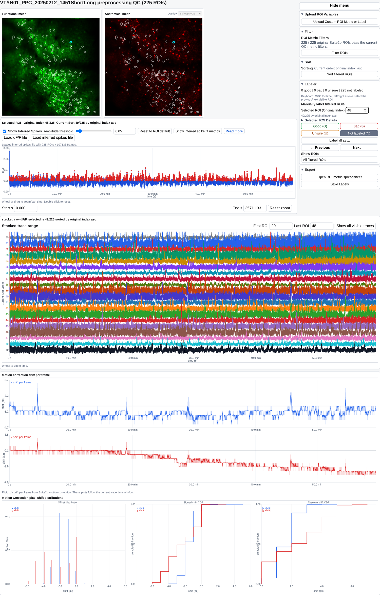

# ROI reviewer demo

This repository builds an interactive, self-contained reviewer for region-of-interest
quality control in two-photon calcium imaging. You point it at a processed session and
it writes a single HTML file that embeds the field-of-view images, the per-ROI masks,
the per-ROI metrics and the review interface itself. A reviewer opens that file in a
browser with no installed software, no server and no network connection, labels ROIs,
and saves the reviewed state back into another self-contained copy.

<div class="screenshot screenshot-tall" markdown>

</div>

## What this repository is for

It is a worked, runnable example. The generator here reads a documented input layout,
so output from any segmentation or deconvolution software can be reviewed, not only
Suite2p. Use it to

* review a session of your own, by writing one configuration file;
* convert output from another pipeline into the documented layout;
* check a converted directory before building, so a silent mismatch is caught early;
* read a complete example of each supported input path.

!!! note "Self-contained"
    `pip install -e .` installs everything the generator needs. No laboratory
    package or cluster environment is required.

## How it fits together

```
your segmentation output
        |
        |  scripts/make_standard_inputs.py        (optional converter)
        v
documented input layout  ---->  scripts/validate_inputs.py   (check before building)
        |
        |  scripts/build_reviewer.py config/my_session.yaml
        v
outputs/my_session/
    <name>_interactive_fov_roi_dff.html      the reviewer
    <name>_processing_summary.pdf            static summary
    <name>_dff.npy, <name>_oasis_spikes.npy  sidecar arrays for large sessions
    run.json                                 resolved paths and options
```

For sessions above the embedding threshold the trace arrays are written beside the
HTML as sidecars rather than embedded in it. The HTML and its sidecars must travel
together.

## Where to start

* [Quickstart](quickstart.md) installs the package and builds a reviewer.
* [Preparing Your Inputs](inputs.md) is the input contract, including the one
  correspondence no tool can check for you.
* [Build Configuration](configuration.md) documents every configuration field.
* [Interface Tour](interface.md) walks through the reviewer's panels.
