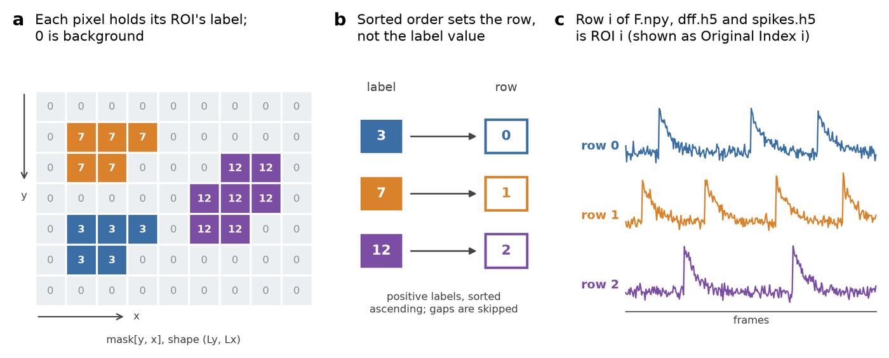
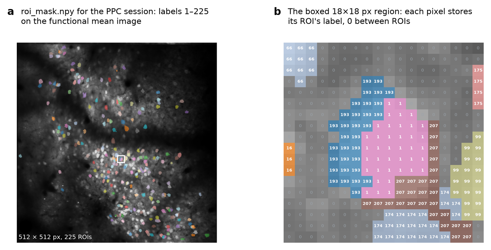

# Preparing your inputs

The reviewer needs four things: where each ROI is, what its fluorescence did over
time, optionally what a spike-inference method made of that, and optionally what kind
of cell it is. Anything that can express those can be reviewed.

## The documented layout

`scripts/make_standard_inputs.py` writes a directory in this form, and
`scripts/validate_inputs.py` checks one against it.

| File | Meaning |
|---|---|
| `roi_mask.npy` | dense 2-D integer label image, one integer per pixel naming the ROI it belongs to; see [Dense label masks](#dense-label-masks) |
| `spatial_components.npz` | alternative to the above: sparse `(pixels, n_rois)` component matrix |
| `F.npy`, `Fneu.npy` | raw fluorescence and neuropil, `(n_rois, n_frames)` float32, C-ordered |
| `dff.h5` (dataset `dff`) | optional precomputed dF/F, `(n_rois, n_frames)` float32 |
| `spikes.h5` (dataset `spikes`) | optional inferred spike amplitudes, same shape |
| `mean_func.npy` | optional functional mean image, `(Ly, Lx)` |
| `roi_cell_type_labels.npy` | optional per-ROI codes: −1 excitatory, 0 unsure, 1 inhibitory, NaN unknown |
| `external_roi_metadata.json` | `image_shape` and `flatten_order`, needed for sparse components without an image |

Sparse component matrices from CaImAn-style pipelines are accepted directly; supply
`flatten_order: "F"` in the metadata file unless your pixel indices are row-major.

!!! danger "HDF5 for dF/F and spikes, not .npy"
    The generator reads dF/F and inferred spikes **only** from HDF5, at the dataset
    names above. A `dff.npy` or `spikes.npy` placed beside them is ignored without
    warning, which is why the validator reports one as an error.

    ```python
    import h5py
    import numpy as np

    with h5py.File("dff.h5", "w") as handle:
        handle.create_dataset("dff", data=np.ascontiguousarray(dff, dtype=np.float32))

    with h5py.File("spikes.h5", "w") as handle:
        handle.create_dataset("spikes", data=np.ascontiguousarray(spikes, dtype=np.float32))
    ```

    These are HDF5 on the input side because they are multi-array stage outputs that
    carry companion arrays and file attributes. The `.npy` form appears only on the
    output side, in the sidecars the browser reads, where a header simple enough to
    parse in a few lines of JavaScript is what keeps the reviewer self-contained.

If `dff.h5` is absent the generator computes dF/F from `F.npy` and `Fneu.npy`.
Inferred spikes have no such fallback: without `spikes.h5`, the spike overlay and
every inferred-spike metric are unavailable, and the reviewer says so rather than
showing an empty panel.

## Dense label masks

A dense label mask is a single 2-D integer array with the same height and width as
the field of view. Each pixel holds the number of the ROI it belongs to, and `0` means
the pixel belongs to no ROI. It is the format most segmentation tools can export
directly: Cellpose's `masks` output, a scikit-image `label()` result, or an ImageJ ROI
set rasterized to one label image are all already in this form.

<div class="screenshot" markdown>

</div>

The example uses labels 3, 7 and 12 to show the general case. Label 7 sits
highest in the image, but label 3 is smallest, so label 3 becomes row 0: rows follow
label value, not position, and the gaps between labels are skipped.

**File and shape.** Saved as `roi_mask.npy` (also found as `roi_masks.npy`,
`label_mask.npy` or `masks.npy`) in the input directory. The array is indexed
`mask[y, x]`, rows first, so its shape is `(Ly, Lx)`: the same shape as
`mean_func.npy` and in the same pixel coordinates as the movie the traces were
extracted from. Use an integer dtype (`int32` is safe for any realistic ROI count).

**How labels become ROI rows.** The generator collects every distinct positive label,
sorts them in ascending order, and assigns them to rows `0, 1, 2, …` in that order. Row
*i* of the mask set is paired with row *i* of `F.npy`, `Fneu.npy`, `dff.h5` and
`spikes.h5`. When the labels run `1, 2, …, N` with no gaps, this reduces to the short
rule "label *k* is row *k − 1*". When they do not, the sorted order still applies:
labels `{3, 7, 12}` become rows `0, 1, 2`, so the traces must be in that same order.

**What the reviewer shows as the ROI's index.** The "Original Index" in the labeler, the
exported spreadsheet and `roi_manual_labels.npy` is the row number, not the label
value. If your labels have gaps and you need to map reviewed ROIs back to them, keep the
sorted label list (`np.unique(mask[mask > 0])`): entry *i* is the label of row *i*. The
generator records the label as `source_label` in its internal ROI table but does not
display it.

**One ROI per pixel, no weights.** Each pixel can belong to only one ROI, so a dense mask
cannot express overlapping ROIs, and every pixel of an ROI counts equally. If your
segmentation produces overlapping or weighted footprints, as CaImAn's spatial
components do, supply them as `spatial_components.npz` instead; see
[Overlapping ROIs](#overlapping-rois).

**What is ignored.** Zero and negative values are treated as background. A label may
cover several separate patches of pixels; they form one ROI, and its connectivity
metric reports how many patches there are.

**What is checked, and what is not.**

| Check | Where |
|:---|:---|
| The mask is 2-D | generator and validator, as an error |
| The number of labels equals the number of trace rows | validator, as an error |
| Labels run `1..N` without gaps | validator, as a warning (gaps are legal, but are the usual sign of a row-order mismatch) |
| The mask has the same shape as the mean image | not checked: a mismatch draws outlines in the wrong place |
| Label *k* really belongs to the trace in its row | not checkable; see [below](#the-one-thing-no-tool-can-check) |

If the counts disagree and validation is skipped, the generator uses only as many ROIs
as both the mask and the traces have, without warning.

**Making one.** From per-ROI boolean masks, in the same order as your traces:

```python
import numpy as np

mask = np.zeros((Ly, Lx), dtype=np.int32)
for row, roi in enumerate(roi_masks):      # roi: boolean (Ly, Lx) array
    mask[roi & (mask == 0)] = row + 1      # first ROI wins where two overlap
np.save("roi_mask.npy", mask)
```

From a label image whose numbering does not match your trace order, pass
`--row-order` to `scripts/make_standard_inputs.py` with the label of each trace row; it
renumbers the mask to `1..N` in trace order.

### Worked example: the PPC demo session

Download [`roi_mask.npy`](examples/ppc/roi_mask.npy) (512 KB) and
[`mean_func.npy`](examples/ppc/mean_func.npy) (1 MB) for the posterior parietal cortex
session shown throughout these docs.

<div class="screenshot" markdown>

</div>

| Property | Value |
|:---|:---|
| Shape, dtype | `(512, 512)`, `int16` |
| Labels | `1..225`, gap-free, so label *k* is row *k − 1* |
| Matches | the 225 rows of the session's `F.npy`, and of the `_dff.npy` and `_oasis_spikes.npy` arrays in its [archived record](demo-sessions.md#try-them-without-installing-anything) |
| ROI pixels | 12,614 of 262,144; median 56 per ROI |

```python
import numpy as np

mask = np.load("roi_mask.npy")              # (512, 512) int16
labels = np.unique(mask[mask > 0])          # array([1, 2, ..., 225])
roi_17 = mask == 18                         # boolean mask of ROI row 17
print(roi_17.sum(), "pixels")
```

The file was made from the session's Suite2p `stat.npy`, which stores each ROI as
pixel lists with a weight per pixel (`ypix`, `xpix`, `lam`). Suite2p lets ROIs overlap
(this session ran with `allow_overlap: True`), but a dense mask cannot, so:

* **452 pixels belong to more than one ROI** in `stat.npy`, touching 73 of the 225 ROIs.
* Each shared pixel was given to the ROI with the **larger weight** at that pixel.
* As a result 68 ROIs are slightly smaller in the mask than in Suite2p, by 458 pixels in
  total. No ROI disappeared.

```python
mask = np.zeros((ops["Ly"], ops["Lx"]), dtype=np.int16)
best = np.zeros(mask.shape, dtype=np.float32)
for i, roi in enumerate(stat):
    y, x, w = roi["ypix"], roi["xpix"], roi["lam"]
    win = w > best[y, x]                    # this ROI outweighs the current owner
    mask[y[win], x[win]] = i + 1
    best[y[win], x[win]] = w[win]
```

!!! note "This is an illustration; a Suite2p session does not need it"
    For a Suite2p session the generator reads `stat.npy` directly and keeps every
    overlapping pixel and weight. Converting to a dense mask only changes the outlines and
    the morphology metrics recomputed from them (area, compactness, aspect ratio) for the
    ROIs that shared pixels. The traces do not change, because they come from `F.npy`,
    which Suite2p extracted from the full, overlapping ROIs.

### Overlapping ROIs

A dense mask stores one label per pixel, so overlaps must be resolved before saving it.
Choose by what your segmentation produced:

| Your ROIs | Supply | What happens to shared pixels |
|:---|:---|:---|
| Suite2p `stat.npy` | the Suite2p layout | kept in every ROI, with their weights |
| Overlapping or weighted footprints (CaImAn `A`, NMF-style methods) | `spatial_components.npz` | kept in every ROI, with their weights |
| Non-overlapping labels (Cellpose, watershed, hand-drawn) | `roi_mask.npy` | none exist |
| Overlapping binary masks you must flatten | `roi_mask.npy` | your choice: highest weight wins (above), first ROI wins, or set to 0 so they belong to no ROI |

Whichever you choose, the traces should come from the same ROIs you are reviewing. If
they were extracted from overlapping masks, the reviewer still pairs each trace with its
row correctly; only the drawn outline and the shape metrics reflect the flattened mask.

## Motion offsets

One value per frame, `shape = (n_frames,)`. The generator reads `xoff` and `yoff` from a
session-level `move_offset.h5`, and otherwise from Suite2p's `ops.npy`. Where the
lengths differ the viewer uses the overlap with the dF/F frame count; where no offsets
exist the motion panels report their absence.

## Cell-type labels

Optional, and independent of the Good/Bad/Unsure review labels. The generator looks
for `suite2p/plane0/roi_cell_type_labels.npy`, then `roi_cell_type_labels.npy` at the
session root, then a `labels` dataset in `masks.h5`. Use one value per ROI:
`1` inhibitory/red, `-1` excitatory/non-red, `0` unsure, `NaN` unavailable.

```python
cell_type_labels = np.full(n_rois, np.nan, dtype=np.float32)
cell_type_labels[red_roi_indices]       =  1
cell_type_labels[non_red_roi_indices]   = -1
cell_type_labels[uncertain_roi_indices] =  0
np.save("roi_cell_type_labels.npy", cell_type_labels)
```

The same labels can be uploaded into an open reviewer with **Upload Custom ROI Metric
or Label**, as a CSV with `cell_type_code,cell_type_label` columns and optionally a
`suite2p_index`, `roi` or `index` column. Without an index column, rows are taken in ROI
order and the file needs exactly one row per ROI.

## ROI model scores

Optional per-ROI classifier output, read from the first of `roi_model_scores.h5`,
`roi_qc_predictions.h5` or `roi_predictions.h5` at the session root.

| Dataset or attribute | Content |
|:---|:---|
| `probability` | float per ROI: the classifier's P(Good) |
| `state` | string per ROI: `good`, `bad`, or `gray` for undetermined |
| `suite2p_roi` or `roi` | optional original ROI index per row; otherwise rows are in ROI order |
| attributes `good_threshold`, `bad_threshold` | the thresholds that produced `state` |
| attributes `target_structure`, `model_source`, `model_path` | provenance carried into the reviewer |

```python
import h5py
import numpy as np

with h5py.File("roi_model_scores.h5", "w") as handle:
    handle.create_dataset("probability", data=probability.astype(np.float64))
    handle.create_dataset("state", data=np.array(states, dtype="S"))
    handle.create_dataset("suite2p_roi", data=np.arange(len(probability)))
    handle.attrs["good_threshold"] = 0.85
    handle.attrs["bad_threshold"] = 0.15
```

The probability appears under **Model Derived Metrics** in the filter and sort menus. The
states are used only when the build sets `initialize_labels_from_model_scores: true`,
in which case ROIs open as Good, Bad or Unsure.

## Converting from another pipeline

```bash
python scripts/make_standard_inputs.py \
    --masks  segmentation/cell_masks.npy \
    --traces segmentation/traces.npy \
    --out    data/my_session
```

| Option | Use |
|---|---|
| `--masks` | dense 2-D integer label image (`.npy`, `.npz`, `.csv`) |
| `--traces` | raw fluorescence, ROIs by frames or frames by ROIs |
| `--neuropil` | optional neuropil traces, same shape as `--traces` |
| `--spikes` | optional inferred spike amplitudes, same shape as `--traces` |
| `--dff` | optional precomputed dF/F; omit to let the generator compute it |
| `--fov` | optional functional mean image |
| `--cell-types` | optional per-ROI codes |
| `--row-order` | the mask label belonging to each trace row, in row order |
| `--out` | output directory |

The converter transposes a frames-by-ROIs trace matrix, compacts mask labels that are
not a gap-free run from 1, and writes dF/F and spikes as HDF5.

## Validate before you build

```bash
python scripts/validate_inputs.py data/my_session
```

It reports shape disagreements, a mask label count that does not match the trace row
count, arrays that are not C-ordered, a stray `.npy` where HDF5 is expected, and files
it cannot read at all. It exits non-zero when it finds an error, so it can gate a
pipeline step. `build_reviewer.py` runs the same checks unless you pass
`--skip-validation`.

## The one thing no tool can check

Whether mask label *k* really belongs to trace row *k−1*.

A mismatch produces a reviewer in which every mask is paired with the wrong trace.
Every array has the right shape, every check passes, and nothing in the interface
flags it. Pass `--row-order` if your segmentation numbers masks and traces
differently, and spot-check one known-active ROI before trusting a session: select it
in the field of view and confirm the trace panel shows the activity you expect in the
place you expect it.
