# Interface tour

Everything below is one HTML file. The screenshots come from the demo posterior
parietal cortex session, 225 ROIs over 107,135 frames with an anatomical second
channel and excitatory/inhibitory labels.

## Field of view

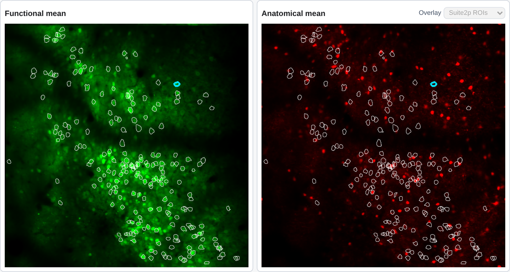

Outlines on the functional mean image are clickable and correspond to the segmented
masks. Scroll and drag zoom and pan, which matters for dense fields. Where anatomical
imaging is available an anatomical mean panel sits beside it, with an overlay selector
for which ROI set to draw. Selecting an outline updates every linked panel.

## Selected ROI trace

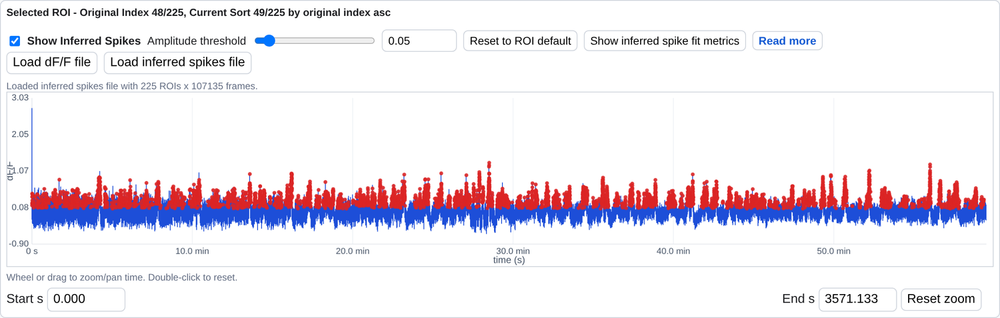

The dF/F trace for the selected ROI, with inferred spikes drawn over it. The amplitude
threshold is adjustable per ROI, and `Reset to ROI default` returns it to the value the
generator computed. The two load buttons are the manual path for the sidecar arrays.
Wheel or drag to zoom and pan in time; the window applies to the motion panel as well.

## Inferred-spike diagnostics

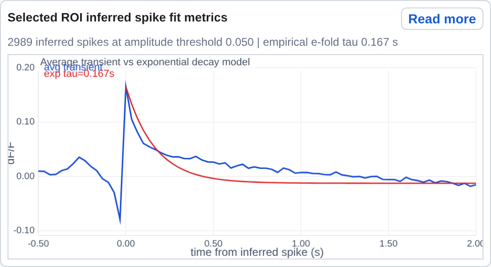

Opened from the trace panel. The event-triggered average transient at the current
amplitude threshold is shown against an exponential decay model, with the count of
events and the empirical decay time constant in the header. This is the panel to check
when a spike count looks implausible: a trace whose average transient does not resemble
a calcium event is one where the inference has latched onto something else.

## Metric filters

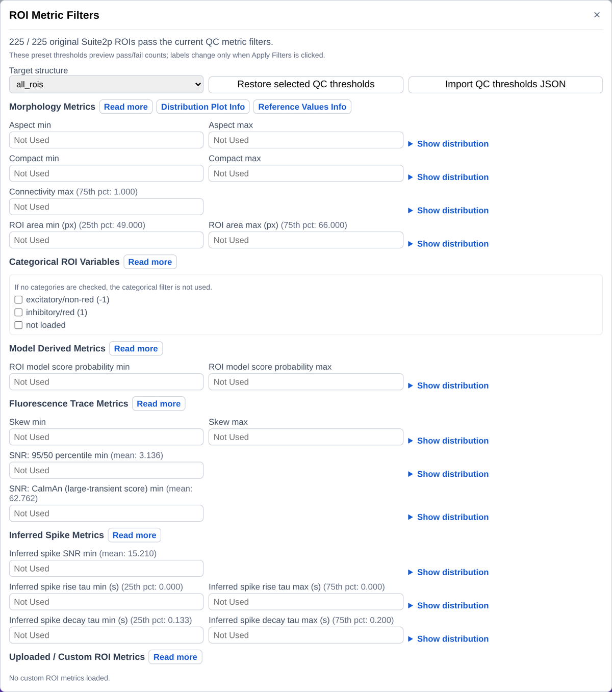

No thresholds are active by default and every ROI passes. Editing a field immediately
updates the pass/fail count and the distribution previews. The field of view, the
set of ROIs that arrow keys step through, and the labels change when
`Apply Filters` is clicked, which marks passing ROIs not labeled and failing ROIs Bad.
After manual labeling, refresh the view with a sort rather than pressing
`Apply Filters` again, which would reset every label. Filters compose conjunctively, and the metric spreadsheet
export records which thresholds each ROI failed.

Beside each numeric field the menu reports a reference statistic computed from the ROIs
in this file. These describe the current population so a candidate cut can be seen in
context. They are not recommendations.

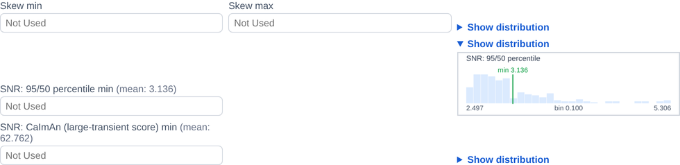

`Show distribution` draws the metric's distribution across the session with markers that
track the threshold fields, so a cut can be placed against the actual population rather
than guessed from a number.

## Sorting

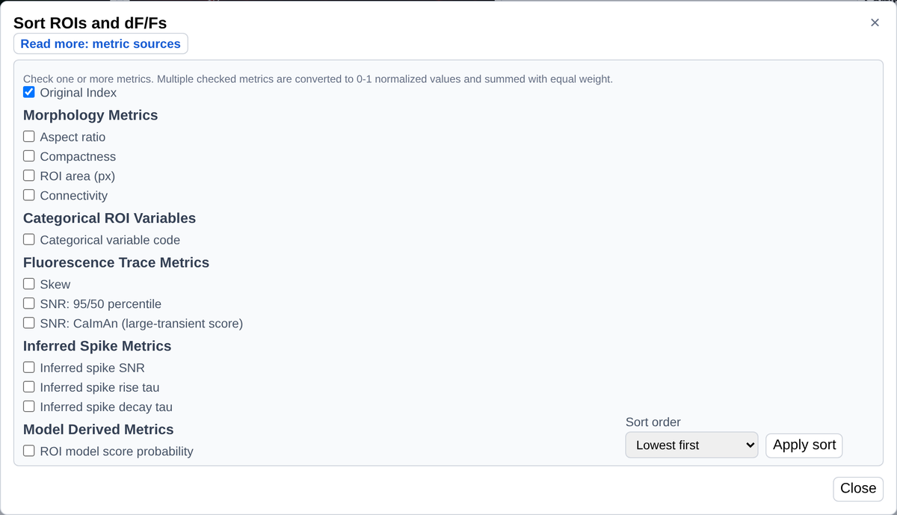

Any metric can be a sort key. Checking several converts each to a 0-1 normalized value
and sums them with equal weight. The sort order drives arrow-key stepping, so a
reviewer can walk the ROI set worst-first by whatever definition of worst the session
calls for.

## Labeling

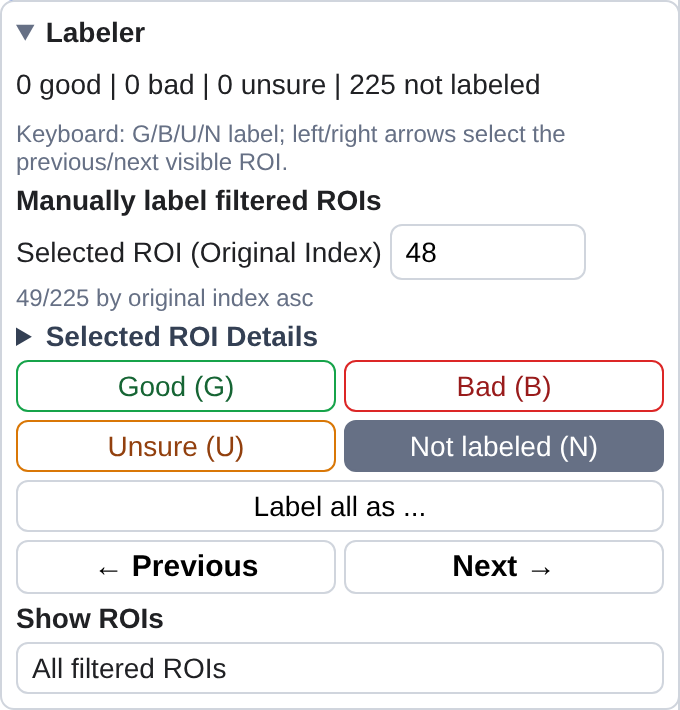

Good, bad, unsure and not labeled, by button or by single keystroke, with left and
right arrows stepping through the visible ROIs in the current sort order. The header
keeps a running count of each label.

### Visibility by label

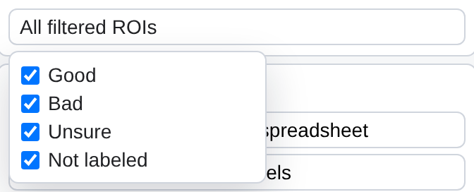

Visibility can be restricted by label, which is how a second pass over just the unsure
ROIs is done. Visibility is applied after the metric filters, so the two compose.

### Bulk labeling

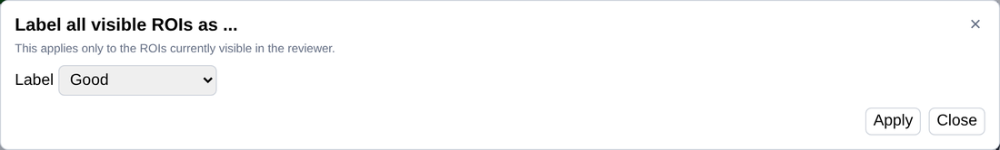

`Label all as` applies one label to every currently visible ROI. A filter plus a bulk
label is therefore a recorded, reproducible decision rather than a long click sequence.

### Export

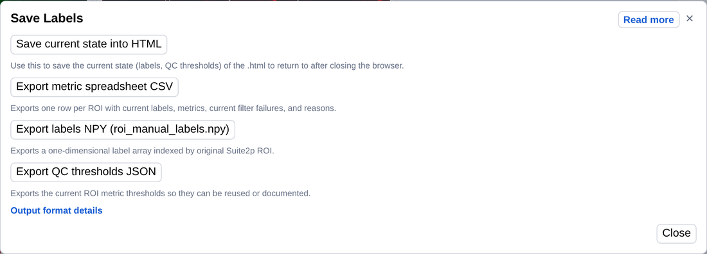

The export menu writes the reviewed state back into a new self-contained HTML, a
per-ROI metric table as CSV including which thresholds each ROI failed, the labels as a
one-dimensional array indexed by original ROI index, and the active thresholds as JSON
for reuse on another session.

## Stacked traces

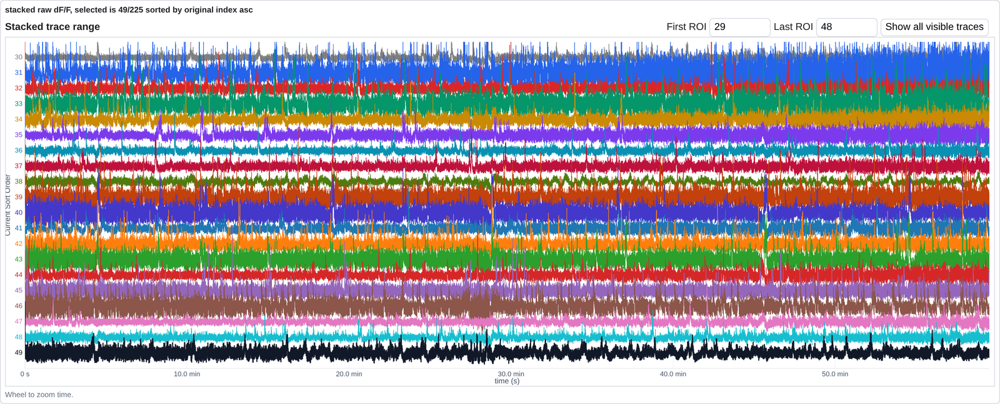

A block of consecutive ROIs in the current sort order, which is how duplicated
detections of one cell are spotted: two rows carrying the same events are two ROIs
sharing a source.

## Motion correction

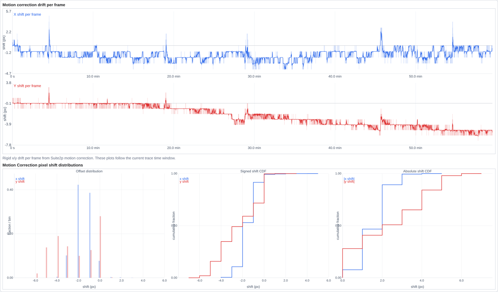

Per-frame rigid drift, following the same time window as the trace panels, with shift
distributions and cumulative distributions below. A session whose traces look odd at a
particular time is often a session that moved then.
