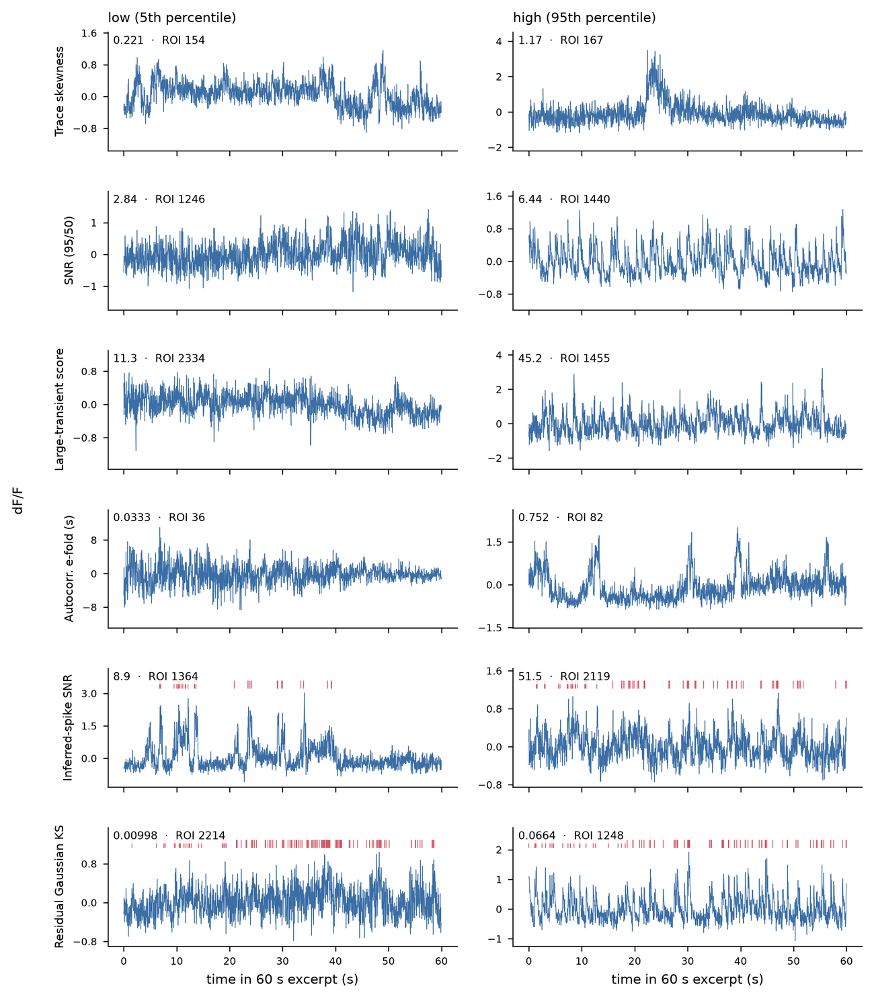

# Metric reference

Every metric in the reviewer's filter and sort menus is listed here with the column
it maps to in the exported metric spreadsheet. The spreadsheet also carries
`suite2p_index`, `manual_label`, `roi_model_score_state`, one `custom_<name>` column per
uploaded metric, and `reason`, listing the active thresholds each ROI failed. Metrics are named by what they measure;
where a definition comes from another package, the package is cited in the definition.

All metrics are computed once by the generator and embedded per ROI. The browser
filters and sorts on those stored values and never recomputes them, so the numbers a
reviewer sees are the numbers a downstream script reads from the exported CSV.

Fields marked *(Suite2p)* are read from `stat.npy` for a Suite2p session and recomputed
by the generator for external masks. The two are not always on the same scale; see
[Build Configuration](configuration.md#target_structure) before using a morphology
preset on external masks.

| Display name | Export column | Definition | Direction |
|:---|:---|:---|:---|
| **Morphology** | | | |
| Aspect ratio | `aspect_ratio` | Elongation of the ROI mask *(Suite2p)*. External masks: bounding-box longer side ÷ shorter side | n/a |
| Compactness | `compact` | Deviation of the mask from a compact disk *(Suite2p)*. External masks: a perimeter-based form on a different scale | Lower is rounder |
| Connectivity | `connectivity` | Number of 4-connected components in the ROI pixel mask | 1 = single component |
| ROI area | `roi_area_px` | Number of pixels in the ROI mask | n/a |
| Footprint | `footprint` | Suite2p detection-scale index *(Suite2p)*; see the warning below. External masks: bounding-box fill fraction | n/a |
| **Categorical ROI variables** | | | |
| Categorical variable code | `category_code` | Loaded label: −1 excitatory/non-red, 0 unsure, 1 inhibitory/red, NaN unavailable | Categorical |
| Categorical variable label | `category_label` | Text form of the code | Categorical |
| **Model derived** | | | |
| ROI model score probability | `roi_model_score_probability` | Classifier P(Good) from the [ROI model scores file](inputs.md#roi-model-scores) | Higher = more confident the ROI is good |
| **Fluorescence trace** | | | |
| Skew | `skew` | Skewness of the fluorescence trace *(Suite2p)*. External masks: skewness of the raw fluorescence row | n/a |
| SNR: 95/50 percentile | `snr_95_50` | Robust transient amplitude (95th − 50th percentile of dF/F) ÷ residual noise | Higher = stronger transients relative to noise |
| SNR: CaImAn (large-transient score) | `caiman_exceptional_event_snr` | Exceptional-event score after CaImAn | Higher = stronger large transients |
| **Inferred spikes** | | | |
| Inferred spike SNR | `inferred_spike_snr` | Average event-triggered amplitude ÷ SD of the pre-event baseline | Higher = events stand out from baseline |
| Inferred spike rise tau | `inferred_spike_rise_tau_seconds` | Time between the 10% and 90% crossings of the average event | n/a |
| Inferred spike decay tau | `inferred_spike_decay_tau_seconds` | Time from the average event peak to 1/e of its amplitude | n/a |

Metrics you supply yourself appear under **Uploaded / Custom ROI Metrics**, either from
`custom_roi_metrics` at build time or uploaded into an open reviewer; see
[CLI, Config and Interface](cli-mapping.md).

!!! warning "`footprint` is a detection scale, not a shape"
    Suite2p's `footprint` field is the spatial scale at which an ROI was detected and
    takes only small integer values (0 to 3 in the cerebellar example). A preset window on
    it selects detection scales, not shapes. For external masks the generator substitutes
    a bounding-box fill fraction on [0, 1], which is a different quantity again.

## What low and high values look like

Metric definitions are easier to threshold once you have seen traces at either end of
the range. Each row below is one metric: on the left the ROI nearest that metric's 5th
percentile in the cerebellar example session, on the right the ROI nearest its 95th,
as 60-second excerpts centered on a representative inferred event. Vertical scales
differ between panels.

A low-skew ROI fluctuates around its baseline; the high-skew exemplar sits near
baseline and departs from it once, upward. The inferred-spike SNR pair is the clearest:
at the low end events sit within the surrounding fluctuations, at the high end they are
unambiguous.

!!! note "Two rows show metrics the menus no longer offer"
    The autocorrelation e-fold time is still computed and embedded per ROI but is not in
    the filter or sort menus or the exported table. The residual Gaussian KS score in the
    bottom row is from an earlier version and is no longer computed. Both are kept here
    because the contrasts are instructive.

The exemplars were drawn only from ROIs with 20–400 pixels, at most three connected
components, and |dF/F| ≤ 20. In this session 332 of 2,702 ROIs exceed |dF/F| = 20,
values no calcium indicator produces, which arise when the baseline denominator
approaches zero. Those ROIs take extreme values on several metrics at once, so they
would have illustrated a division artifact rather than the metric. They are exactly the
ROIs review exists to catch.
